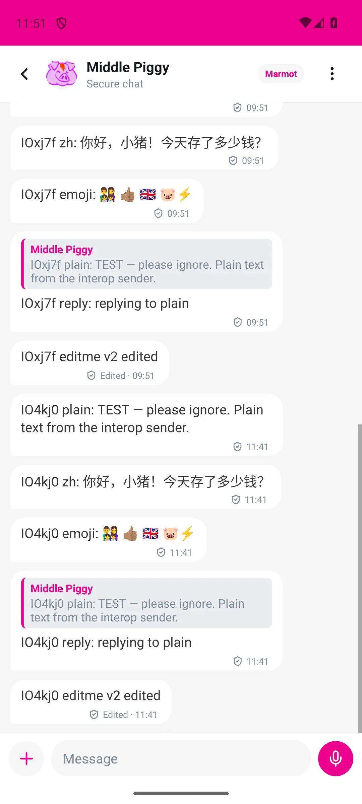
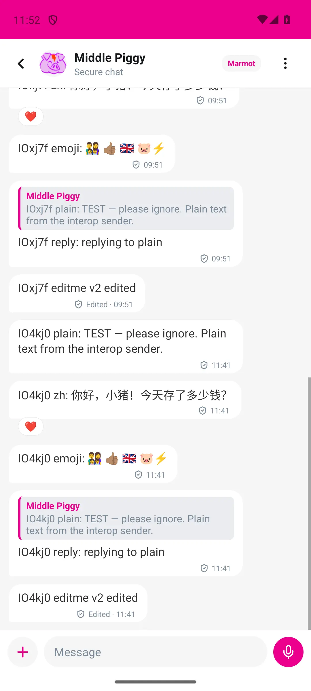

# Reactions on the first cached-message frame

The shared controller previously initialized `reactionRecords` to `[]` on every
mount, then reset it in a scope effect (original
`src/hooks/useConversationReactions.ts:127–150`). Its post-render fetch only starts
once messages provide target rumor ids (now `src/hooks/useConversationReactions.ts:263–289`).
Aggregation itself is synchronous; the delay comes from the separate async fetch.

| Conversation | Initial messages                                                                                                 | Reactions after message commit                                                                                                                                                                                                                |
| ------------ | ---------------------------------------------------------------------------------------------------------------- | --------------------------------------------------------------------------------------------------------------------------------------------------------------------------------------------------------------------------------------------- |
| NIP-17 1:1   | Encrypted DM store via `src/contexts/conversationReadThrough.ts:45` and `src/hooks/useConversationLoader.ts:116` | `src/hooks/useReactionBackend.ts:41` selects the public relay backend; `src/hooks/useReactionActions.ts:120` calls `src/services/nostrReactions.ts:44`, awaiting relay EOSE (10 s maximum). A second query reads kind-5 deletions.            |
| Marmot 1:1   | Same encrypted DM store                                                                                          | `src/hooks/useReactionBackend.ts:28` selects MLS history. `src/services/marmotReactions.ts:69–75` waits for the session, resolves every DM group with that peer, and reads kind-7 history separately; another pass reads kind-5 history.      |
| Marmot group | `src/screens/GroupConversationScreen.tsx:161` reads group messages                                               | `src/hooks/useGroupMessageActions.ts:55–65` supplies the same controller with a group-scoped MLS backend. `src/services/marmotReactions.ts:64` selects the explicit group. The history fetch and aggregation still follow the message commit. |

The fix seeds reaction state synchronously from a bounded per-conversation memory
cache (`src/hooks/useConversationReactions.ts:134–139`). Keys include the viewer
and protocol/peer or group. Cache entries retain author-checked deletion tombstones
and exclude unacknowledged optimistic publishes. The cache holds 30 conversations,
with at most 2,000 records and 2,000 tombstones per conversation. A cold process or
an evicted conversation still hydrates through the existing async backend; subsequent
opens paint known reactions with the messages. Both PR #1417 files are untouched.

Live MLS events retain `useCoalescedMap` batching; their listener now uses
`useFocusEffect`. Relay filters and memoized message rows are unchanged. No spacing,
placeholder, row-height, or chip styling was added: a new live chip contributes only
its existing chip row.

## Measurements

War Machine, `emulator-5554`, active Big Piggy, existing “Polish test” Marmot group.
Metro served this worktree on port 8100. Each run opened the conversation, waited
for the existing chip selector, and returned using `group-back`. Five consecutive
opens before and five after priming the memory cache:

| Open   | Before gap (ms) | After gap (ms) |
| ------ | --------------: | -------------: |
| 1      |             241 |              1 |
| 2      |             265 |              2 |
| 3      |             285 |              4 |
| 4      |             130 |              2 |
| 5      |             121 |              3 |
| Median |             241 |              2 |

Gaps are differences between dev-only `[PerfBlock] chat messages rendered` and
`chat reactions rendered` elapsed markers from React commit effects, not native
frame timestamps. After the fix both markers run in the **same commit**; the 1–4 ms
spread was logging/clock overhead. The final instrumentation uses one elapsed
value for both markers, avoiding that overhead in the reported gap.

The existing Middle Piggy Marmot 1:1 also reproduced a 730 ms before gap
(messages 432 ms, reactions 1,162 ms); a warm reopen after the fix reported both
at 703 ms, a 0 ms gap.

## Screenshots

| Before: heart chips missing | After: both heart chips present |
| --------------------------- | ------------------------------- |
|       |             |

These are unaltered ADB screencaps of that Middle Piggy Marmot chat, converted to
WebP. The capture loop requests frames at offsets 0/150/300/1,000 ms from the
message commit marker. The selected files are the nominal +150 ms frames;
ADB/screencap execution latency means they are **not exact +150 ms native-frame
measurements**, and the offsets are relative to the message commit, not the tap.

Raw PNGs and all capture attempts: `/tmp/claude-1000/shots-reactions/`.
Selected PNGs: `before-middle-1-150ms.png`, `after-middle-1-150ms.png`.
Five-open raw markers: `before-five-timings.log`, `after-five-timings.log` in that
temporary directory. A device-side screencap loop was also tried for the group;
its short native gap did not yield a useful chips-missing frame.

## Validation

The first-render reopen regression failed before for all three backend scopes and
passes after. Related Jest suites pass (62 tests), including group focus reload,
live event batching, late scope writers, deletion authorization, cache isolation,
pending publishes, and memory bounds. TypeScript, ESLint/Prettier on changed files,
`check-file-size`, and `check-perf-antipatterns` pass.

The emulator and Maestro locks were held during device work. No account was
signed in or out, no messages or reactions were sent, and no other device was
controlled. Metro was stopped and the emulator host restored to `10.0.2.2:8090`.
